# Balatro GBA — русская версия v0.4.0-ru

Неофициальная русская сборка фанатского порта **Balatro для Game Boy Advance**
([GBALATRO/balatro-gba](https://github.com/GBALATRO/balatro-gba)). База — релиз v0.2.3 и слияние
апстрима до PR #665. Готовый ром — на странице **Releases** этого репозитория.

<p>
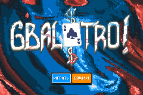 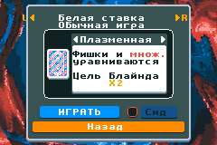
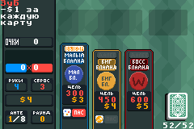 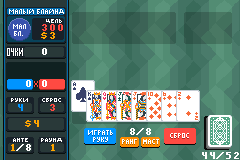
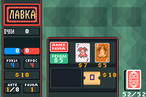 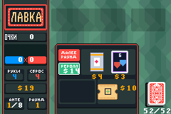
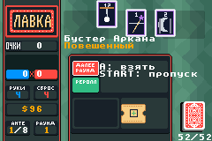 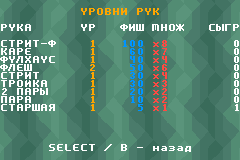
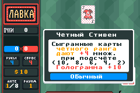 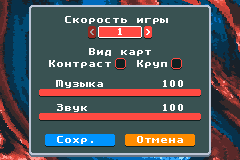
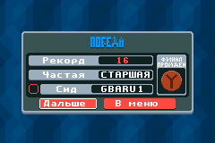 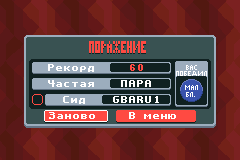
</p>

## Что переведено

- весь интерфейс: меню, опции, настройка забега, блайнды, раунд, конец раунда, лавка, экраны победы и поражения;
- названия колод, комбинаций, джокеров, боссов, ставок, ваучеров, Таро, спектральных карт, планет и улучшений, описания джокеров;
- заставка с предупреждением; надписи, нарисованные прямо в графике, перерисованы.

Из-за размера тайла 8×8 часть подписей сокращена (МАЛ БЛ., СТРИТ-Ф, РОЯЛ-ФЛ, ФЛ-ХАУС, МАСТ и т. п.).
В графике джокеров остались английские слова на самих картинках. Единые термины — `docs/ru/GLOSSARY.md`.

## Что нового в v0.4.0-ru

Относительно v0.3.0-ru:

- **Джокеры.** 149 джокеров (ID 0–148): партии 4–8 добавили 55 новых (ID 94–148), в том числе
  легендарных (Канио, Трибулет, Йорик, Чикот, Перкео), Ретро, Костёр, Невидимого, Матадора и Мима. Подробный список — в `docs/ru/STATUS.md`.
- **Колоды.** 14 колод: к шести прежним добавились Волшебная, Туманность, Призрачная, Заброшенная,
  Клетчатая, Зодиак, Плазменная и Хаотичная.
- **Издания.** Фольга, Голограмма, Полихром и Негатив на джокерах и картах, Колесо фортуны (Таро),
  ваучеры Заточка и Блеск.
- **Спектральные карты.** Спектральные расходники и спектральный бустер, Небесный бустер (планеты),
  Колесо фортуны, ваучеры Шар знамений, Телескоп и Обсерватория.
- **Таро.** Все 22 карты Таро.
- **Ваучеры.** Торговцы и Магнаты Таро и планет, Фокус и Иллюзия и другие.
- **Бесконечный режим.** После победы над боссом 8-го анте можно продолжить забег до анте 12.
  Победа над боссом 12-го анте завершает игру.
- Исправления: размер руки не выходит за массив, Ракета растёт на $2 за босса, испорченный джокер («Скоропорт.») перестаёт
  действовать целиком (Размытый, Ой, все шестёрки, Шоумен, Хаос Клоун), Призрак не обнуляет деньги, если джокер не создан,
  проверки слотов с Негативными джокерами согласованы.

Из ранее добавленного (v0.3.0-ru): 28 боссов, 8 ставок с наклейками, уровни рук и планеты, ваучеры,
улучшения и печати карт, Стандартный бустер и бустер Аркана.

## Чего пока нет

- сохранение забега: в v0.2.3 его отключили из-за зависания при старте (#582);
- бесконечный режим дальше 12-го анте (нужны очень большие числа: мантисса и экспонента);
- коллекция и достижения;
- описания Таро и предметов во время раунда: они показываются только в лавке;
- часть мелких отличий от оригинала описана в разделе «Известные замечания» файла `docs/ru/STATUS.md`.

## Как собрать

Нужны Docker и Docker Compose. Из корня репозитория:

```bash
docker compose run --rm gbalatro
```

Первый запуск собирает образ из `Dockerfile.gbalatro` (на базе `devkitpro/devkitarm`) и сам ром.
Результат — `build/balatro-gba.gba`. Его можно открыть в mGBA или записать на картридж.
Сборка без Docker описана в `CONTRIBUTING.md` (нужен devkitARM).

## Как играть

| Кнопка | Действие |
|---|---|
| Стрелки | перемещение курсора, выбор ставки и колоды |
| A | выбрать карту, джокера или кнопку |
| B | назад; удерживать, чтобы увидеть описание |
| L | сыграть выбранные карты |
| R | сбросить выбранные карты (на экране блайнда — перебросить босса, если есть ваучер) |
| SELECT | экран «Уровни рук» |
| START | пропустить заставку, начать игру |

Цель каждого блайнда — набрать нужное число очков за ограниченное число рук. В конце раунда
получаете деньги, в лавке покупаете джокеров, расходники, ваучеры и бустеры. Ставка меняет условия
забега, поэтому начинайте с Белой.

## Прогон в эмуляторе

Скриптовые сценарии для mGBA со скриншотами — в `ru-tools/emu/` (см. `ru-tools/emu/README.md`).
Скриншоты в `docs/ru/` сняты так же: сборка через Docker, затем `ru-tools/emu/run.py` с готовыми сценариями.

## Кредиты

- **Balatro** создан LocalThunk и Playstack. Проект неофициальный, не связан с ними. Купите оригинальную игру.
- **Порт на GBA** — апстрим [GBALATRO/balatro-gba](https://github.com/GBALATRO/balatro-gba), на нём основана эта сборка.
- **Русская локализация и доработки** — автор этого репозитория.
- План работ и состояние — `docs/ru/ROADMAP.md` и `docs/ru/STATUS.md`. Термины — `docs/ru/GLOSSARY.md`.

---

# English

This branch (`ru-translation`) is a Russian localization of the Balatro GBA fan port (based on release v0.2.3). The original project README follows.

---

# Balatro-GBA

[](https://github.com/cellos51/balatro-gba/actions)
[](https://github.com/cellos51/balatro-gba/issues)
[](https://github.com/cellos51/balatro-gba/pulls)
[![Discussions](https://img.shields.io/github/discussions/cellos51/balatro-gba?style=flat&color=blue&label=Discussions&logo=data:image/svg+xml;base64,PHN2ZyB4bWxucz0iaHR0cDovL3d3dy53My5vcmcvMjAwMC9zdmciIHZpZXdCb3g9IjAgMCAxNiAxNiIgd2lkdGg9IjE2IiBoZWlnaHQ9IjE2Ij48cGF0aCBmaWxsPSJ3aGl0ZSIgZD0iTTEuNzUgMWg4LjVjLjk2NiAwIDEuNzUuNzg0IDEuNzUgMS43NXY1LjVBMS43NSAxLjc1IDAgMCAxIDEwLjI1IDEwSDcuMDYxbC0yLjU3NCAyLjU3M0ExLjQ1OCAxLjQ1OCAwIDAgMSAyIDExLjU0M1YxMGgtLjI1QTEuNzUgMS43NSAwIDAgMSAwIDguMjV2LTUuNUMwIDEuNzg0Ljc4NCAxIDEuNzUgMVpNMS41IDIuNzV2NS41YzAgLjEzOC4xMTIuMjUuMjUuMjVoMWEuNzUuNzUgMCAwIDEgLjc1Ljc1djIuMTlsMi43Mi0yLjcyYS43NDkuNzQ5IDAgMCAxIC41My0uMjJoMy41YS4yNS4yNSAwIDAgMCAuMjUtLjI1di01LjVhLjI1LjI1IDAgMCAwLS4yNS0uMjVoLTguNWEuMjUuMjUgMCAwIDAtLjI1LjI1Wm0xMyAyYS4yNS4yNSAwIDAgMC0uMjUtLjI1aC0uNWEuNzUuNzUgMCAwIDEgMC0xLjVoLjVjLjk2NiAwIDEuNzUuNzg0IDEuNzUgMS43NXY1LjVBMS43NSAxLjc1IDAgMCAxIDE0LjI1IDEySDE0djEuNTQzYTEuNDU4IDEuNDU4IDAgMCAxLTIuNDg3IDEuMDNMOS4yMiAxMi4yOGEuNzQ5Ljc0OSAwIDAgMSAuMzI2LTEuMjc1Ljc0OS43NDkgMCAwIDEgLjczNC4yMTVsMi4yMiAyLjIydi0yLjE5YS43NS43NSAwIDAgMSAuNzUtLjc1aDFhLjI1LjI1IDAgMCAwIC4yNS0uMjVaIj48L3BhdGg+PC9zdmc+)](https://github.com/cellos51/balatro-gba/discussions)

### Disclaimer

This project is a non-profit fan demake of Balatro for the Game Boy Advance, meant to recreate it as accurately as possible including all the visuals that make it satisfying to play. It is **not affiliated with or endorsed by Playstack or LocalThunk** and **it is not to be sold**.  This version is a **minimal tech-demo**, intended for those who already own and know the official game. Refer to the Balatro wiki below for descriptions of game mechanics and joker effects.  All rights remain with the original holders. 

<a href="https://balatrowiki.org/">
  
</a>

### Please buy the official full version from these sources below:

[](https://store.steampowered.com/app/2379780/Balatro/)
[](https://play.google.com/store/apps/details?id=com.playstack.balatro.android)
[](https://apps.apple.com/us/app/balatro/id6502453075)
[](https://www.nintendo.com/us/store/products/balatro-switch/)
[](https://store.playstation.com/en-us/concept/10010334)
[](https://www.xbox.com/en-US/games/store/balatro/9PK087LNGJC5)
[](https://www.humblebundle.com/store/balatro?srsltid=AfmBOoqS2De8T4kizzWxJS1pbvQosJ_bYCl4qvC6LA1YLPAh4sZ8vJqO)

---

<a href="https://github.com/cellos51/balatro-gba/releases/">
  
</a>

See **_CONTRIBUTING.md_** for build instructions for Docker, Linux, MacOS, and Windows.

---


https://github.com/user-attachments/assets/54a9e2e9-1a02-48d5-bb9d-5ab257a7e03b


### Controls:

(A: Pick Card / Make Selection)

(B: Deselect All Cards)

(L: Sell Joker  / Play Hand)

(R: Discard Hand)

(Hold A + D-Pad: Move Cards and Jokers in Hand)

(Hold B: Display Joker Description **_Shop Only_**)

# Contributing

If you would like to contribute, please read CONTRIBUTING.md.

# **Credits:**
## **Game**
This GBA implementation is based on Balatro which is designed and created by LocalThunk and published by Playstack.
See repository contributors list for code contribution credits to this GBA implementation.
## **Music**
Music arrangement is made by @cellos51 and @MeirGavish based on original Balatro soundtrack by [LouisF](https://louisfmusic.com/) and [transcription by MrCrimit](https://musescore.com/user/8237321/scores/14590660).
## **Imagery**
Sprites and backgrounds are based on original Balatro imagery created by LocalThunk.
See [Joker Art Discussion](https://github.com/cellos51/balatro-gba/discussions/69) for full credits for each joker sprite.
## **Sounds**
For the mult and xmult sound effects: [Toy records#06-E3-02.wav by poissonmort](https://freesound.org/s/253249/) used under License: Attribution 4.0

All other sound effects were created by LocalThunk and are used under Creative Commons - CC0 license. 
